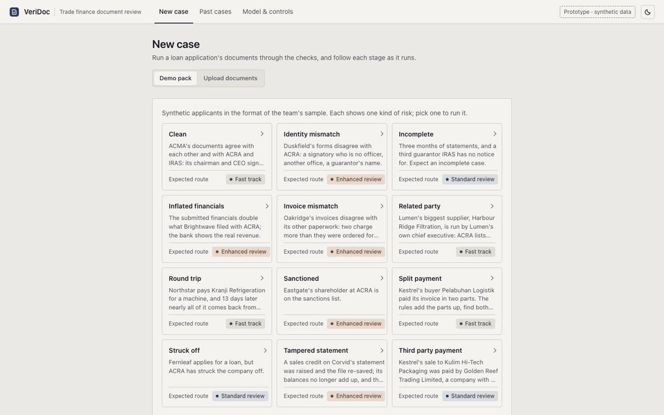
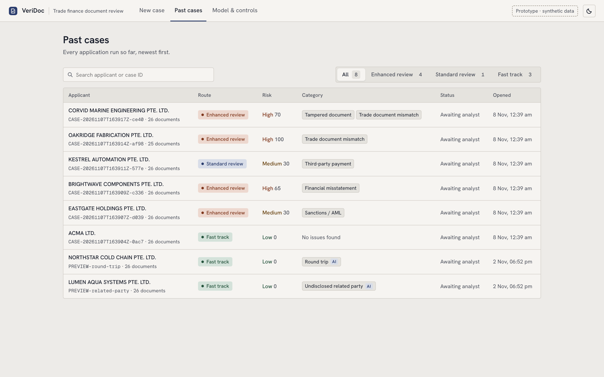
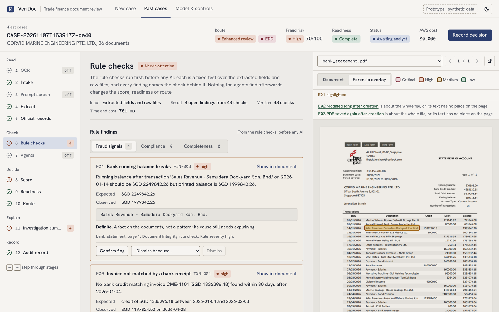
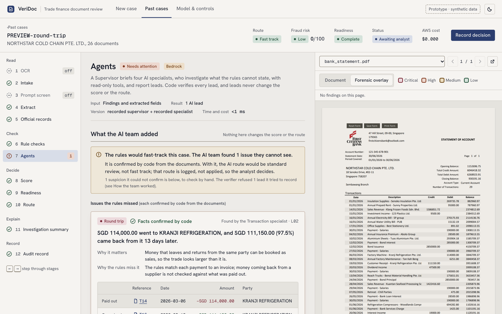
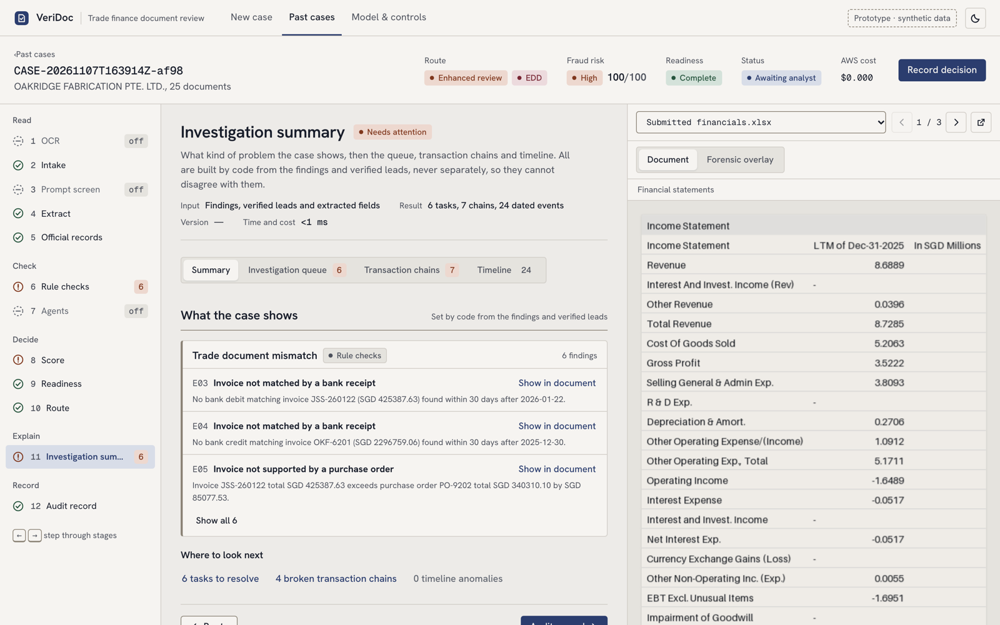
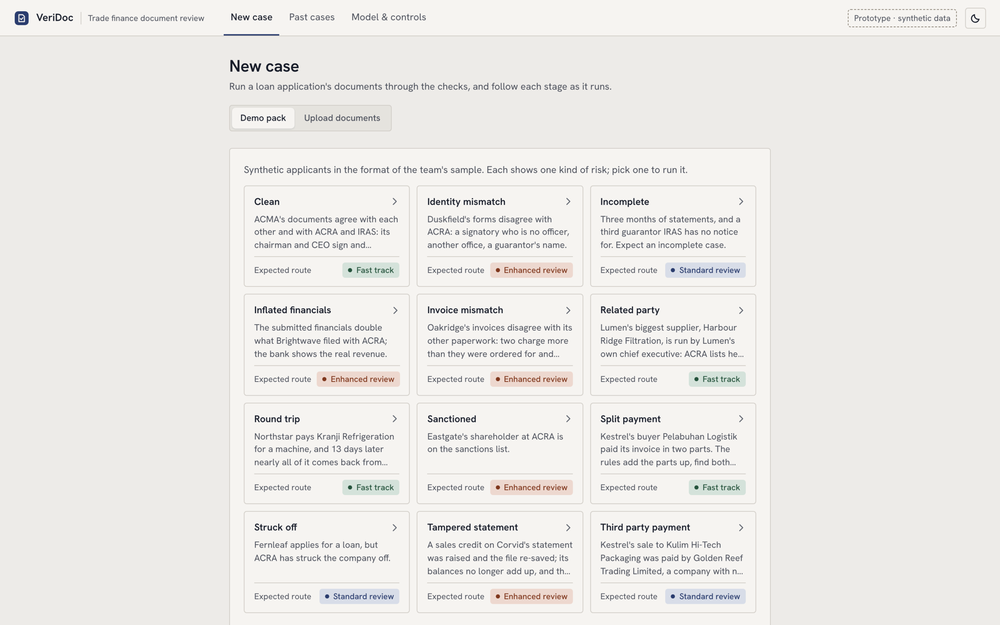
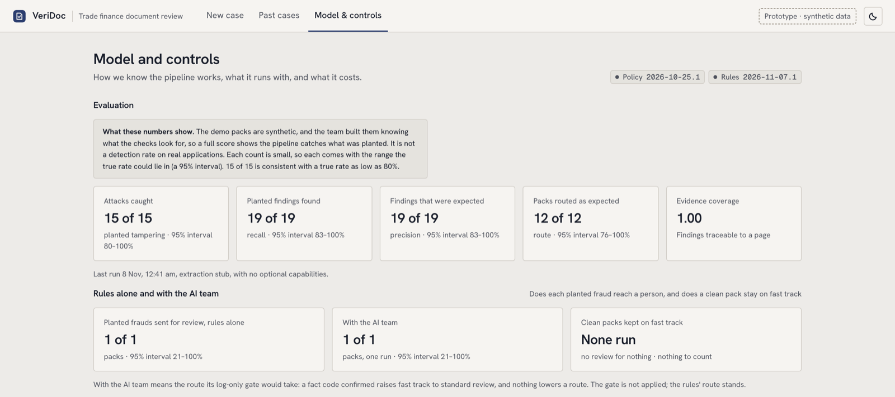
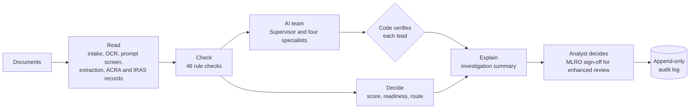
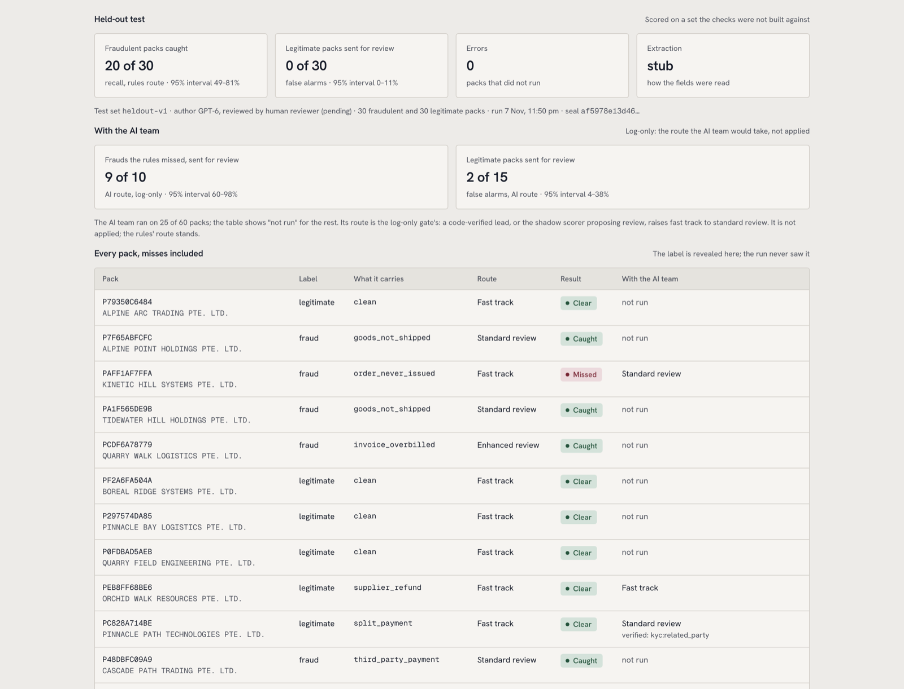

<div align="center">

# VeriDoc

### Catch document fraud in trade-finance loan applications before it reaches credit

Rule checks that read every document, an AI team that looks where rules cannot,
and a reviewer who sees exactly why, on the page it came from.

**[Open the live prototype → veridoc.tail4bd12e.ts.net](https://veridoc.tail4bd12e.ts.net)**<br>
<sub>Sign-in needed: ask the project admin for the username and password.</sub>




<sub>A prototype built for Green Link Digital Bank (GLDB). Synthetic data only; not for production use.</sub>

</div>

---

## Why VeriDoc

A trade-finance application arrives as a pile of documents: bank statements, invoices,
purchase orders, bills of lading, tax forms and financial statements. Fraud hides in the gaps
between them. An invoice bills more than was ordered. A sale is paid by a company with no part in
it. A bank balance was edited and the PDF saved again. Money paid to a supplier comes back as a
"customer receipt". Each document looks fine on its own; the fraud is in how they disagree.

VeriDoc reads the whole pack the way a careful analyst would, then shows its work.

| | |
|---|---|
| **48 rule checks** | Every invoice traced through its order, shipment and payment; balances re-added; registry, tax and sanctions records fetched and compared; forensics on every PDF |
| **An AI team on Amazon Bedrock** | A Supervisor and four specialists (transaction, KYC, forensics, timeline) investigate what no rule covers |
| **Code checks the AI** | Every AI lead is verified against the documents by code before anyone sees it; the AI never sets the score or the route |
| **Every finding on its page** | Click any finding and the document opens with the exact line boxed |
| **Built for review, not autopilot** | The system routes and explains; an analyst decides, and enhanced reviews need an MLRO sign-off |

## See it in action

### A queue that triages itself

Each application is scored, banded and routed (fast track, standard review or enhanced due
diligence), with the kind of problem it shows at a glance.



### Every finding, on the page it came from

Rule findings come with what was expected, what was observed and the quote behind it. The
forensic overlay boxes every finding on a page at once, coloured by severity.



### An AI team that looks where the rules cannot

Here the rules fast-track the case: every row on the statement looks normal on its own. The
AI team links SGD 114,000 paid to a supplier with SGD 111,150 coming back from it 13 days later,
and code confirms the pair from the statement before it is shown.



### The whole case in one place

The investigation summary groups what the case shows, the analyst's queue, each invoice's chain
from order to payment, and a timeline of every dated fact.



### Start from a demo pack or your own documents

Twelve synthetic applicants, each showing one kind of risk, run end to end with no AWS account.



### Measured, with the uncertainty shown

The Model & controls page scores the pipeline against every demo pack, with a 95% interval on
each count, and shows the rule versions, capabilities and AWS spend behind it.



## How it works



1. **Read.** Files are fingerprinted and typed, scanned pages are read by Amazon Textract, and
   text aimed at an AI model is flagged. The bank fetches the company's ACRA profile and the
   guarantors' IRAS notices instead of trusting uploaded copies.
2. **Check.** 48 deterministic rule checks in parallel groups: document integrity, cross-document
   consistency, registry and tax records, sanctions and FATF countries, forms and completeness.
3. **Decide.** A rule-based score sets the risk band, readiness and route. No language model
   touches the score.
4. **Investigate.** The AI team works from read-only tools and records leads. Code checks each one
   against the case data; only verified leads reach the analyst, and nothing the team says changes
   the route.
5. **Record.** Every stage and every analyst action goes to an append-only audit log.

## Results

| Test | What it shows | Result |
|---|---|---|
| **Demo packs** (12 applicants built by the team) | The pipeline catches what was planted | 15 of 15 attacks caught, 12 of 12 packs routed as expected |
| **Blind test, rules** (60 applicants written by a separate model, GPT-6, from public fraud typologies; system frozen at tag `eval-v1` first) | How it does on cases it was not built around | 20 of 30 frauds sent for review, **0 of 30 honest applications flagged**, including 15 innocent look-alikes |
| **Blind test, with the AI team** (log-only route, run on the 10 frauds the rules sent through and the 15 look-alikes) | What the AI team adds where the rules stop | 9 of the 10 would reach review (4 of 5 round trips found and confirmed by code); 2 of 15 look-alikes flagged |



The misses are reported, not hidden. The rules sent through five round trips, which no rule
looks for, and five orders that were never issued, which a rule found but scored below the
review threshold. The AI team's two false alarms trace to the test's generator, which reused
two officers' names across companies. Every set is synthetic and read in layouts the parser was
written for, so none of this is a detection rate on real applications;
[docs/PROJECT_STATUS.md](docs/PROJECT_STATUS.md) has the full picture.

## Try it

**Hosted:** the prototype runs at **https://veridoc.tail4bd12e.ts.net**. It asks for a username
and password; ask the project admin for them. To save cost the server stops at 1am Singapore
time and after two idle hours; if the page does not load, ask the admin to start it (anyone
with write access to the repository can, from Actions > Start server > Run workflow).

**Self-hosted:** everything below is only needed to run your own copy. The quick start runs
fully offline: no AWS account needed for the demo packs.

```bash
python -m venv .venv && source .venv/bin/activate
pip install -r requirements.txt && cp .env.example .env
uvicorn mock_gov.app:app --port 8001 &      # mock ACRA and IRAS records
uvicorn gldb.api:app --port 8000 &          # backend
cd frontend && npm install && npm run dev   # open http://localhost:5173
```

Pick a demo pack on **New case** and follow it through. The sections below cover AWS, tests,
evaluation and the project layout in full.

> Current status, what is built and what is next: [docs/PROJECT_STATUS.md](docs/PROJECT_STATUS.md)

## Setup

These steps are for running your own copy. To use the prototype, open the hosted version at
**https://veridoc.tail4bd12e.ts.net** (sign-in needed: ask the project admin for the username and
password).

### 1. Prerequisites

- Python 3.11
- Node 20+ (frontend)
- AWS account with Bedrock access (Claude model enabled in your region); Textract if you want to OCR scans

### 2. Create a virtual environment

```bash
python -m venv .venv
# Windows
.venv\Scripts\activate
# macOS / Linux
source .venv/bin/activate
```

### 3. Install dependencies

```bash
pip install -r requirements.txt
```

### 4. Configure environment

```bash
cp .env.example .env
```

Edit `.env`. `.env` is gitignored and must never be committed. Each teammate needs their own.

#### Connecting AWS (optional)

The app runs without AWS. With the `.env` copied from `.env.example`, every AWS feature is off and cases use the deterministic parser, so you can run all the demo packs and `pytest` with no AWS account and no login. Do the steps below only to use Bedrock or Textract.

1. **Sign in.** You need access to an AWS account with Bedrock and Textract; that account's admin grants it. Install the AWS CLI 2.32 or later (`brew install awscli`) and run `aws login --profile <name>`, which opens your browser. The session lives in your own `~/.aws`, never in the project, and no keys go in `.env`.
2. **Permissions.** The role needs `bedrock:InvokeModel` and `textract:DetectDocumentText`, and `bedrock:ApplyGuardrail` for the prompt screen. Once per account, enable the Claude model in Bedrock (this needs the Anthropic use-case form) and activate Textract.
3. **Configure `.env`.** Set `AWS_PROFILE=<name>`, `AWS_REGION=ap-southeast-1` and `BEDROCK_MODEL_ID` (a model ID or inference profile ID from the Bedrock console). Then turn on what you want:
   - `EXTRACTION_MODE=llm`: Bedrock extraction.
   - `OCR_ENABLED=true`: Textract reads every page of every PDF except the FATCA/CRS forms (scans, and the fillable bank statement), and what it sees is compared with what the file stores.
   - `AGENTS_ENABLED=true`: the AI agent team on Bedrock (the shadow scorer follows it).
   - `PROMPT_SCREEN_ENABLED=true` with `GUARDRAIL_ID` and `GUARDRAIL_VERSION`: the prompt attack screen. The guardrail belongs to an account and Region, so deploy `infra/guardrail.yaml` with CloudFormation, or ask whoever did for the ID and version. They are not in the repo.

   Restart the backend after editing `.env`.
4. **Check the connection** with `aws sts get-caller-identity --profile <name>`, then the live tests below.

**Where the data is processed.** Textract and the prompt screen's guardrail (classic tier, no cross-Region profile) run in ap-southeast-1. The Claude models do not: every default model ID starts with `global.`, a cross-Region inference profile, so a request is sent from Singapore but may be processed in any AWS commercial Region. That is acceptable for the synthetic demo data, not for a real applicant's documents. The only Claude model Bedrock offers in ap-southeast-1 itself is `anthropic.claude-sonnet-5`, which AWS has not yet enabled for this project's account. Once it is, using it for every model keeps all processing in Singapore; it rejects the temperature and forced tool choice `llm_client.py` sends today, so that needs a code change too.

**Your session expires.** `aws login` refreshes your credentials every 15 minutes, but one login lasts 12 hours at most. After that, a case that needs AWS stops with "AWS call failed: Your session has expired or credentials have changed. Please reauthenticate using 'aws login'. Start a new case". Run `aws login --profile <name>` again and start a new case; if the backend still reports the old error, restart it. AWS calls are billed to the account you signed in to.

### 5. Run tests

```bash
pytest
```

Tests do not call AWS by default. To run the live AWS smoke tests (one Bedrock call, one forced-schema call, one Textract call, and one full AI team run on the `round_trip` pack, about US$0.10-0.30):

```bash
RUN_LIVE=1 pytest tests/test_live_aws.py -v
```

To score the pipeline against the ground truth of every demo pack in `data/packs/`:

```bash
python -m gldb.evaluate                        # deterministic parser
EXTRACTION_MODE=llm python -m gldb.evaluate    # Bedrock (about 30 small calls)
python -m gldb.evaluate --save                 # also keep the report for the UI's controls page
```

To score the AI team (champion vs challenger) on the same packs:

```bash
python -m gldb.agent_eval [--supervisor M] [--specialist M] [--runs N] [--only PACK,...] [--save]
# One model setup per run (defaults: the configured models). Calls Bedrock whatever
# AGENTS_ENABLED says; about US$1-3 per pass. The team is not deterministic, so --runs 1-3
# runs every pack that many times. Run it again with other models for the challenger.
# --only PACK,... runs just those packs (about US$0.25 a pack); with --save it patches
# the saved row instead of replacing it, so one pack can be refreshed without re-running the rest.
```

On the prototype server, run **Actions > Run evaluation** on GitHub instead (the server must be running). It
evaluates the deployed code and saves both reports for the Model & controls page: the rules evaluation always, at
no cost, and the AI team when ticked, for 1 to 3 runs. The page shows counts with 95% intervals, and each planted
fraud's route with the rules alone and with the AI team.

### The blind held-out test

The demo packs were built knowing the checks, so they show only that the pipeline catches what was planted. A blind
held-out test closes that gap: an independent author writes a scenario sheet (which packs are fraudulent, which are
legitimate, and where), the renderer draws the documents mechanically, and the system is scored against a sealed
answer key it never saw. See `docs/heldout-preregistration.md` and `docs/heldout-author-guide.md`.

```bash
python -m gldb.heldout generate --sheets SHEET.json --out DIR --key KEY.json --seed SEED  # render + seal
python -m gldb.heldout run --packs DIR/packs --out RESULTS.json [--ai-team] [--runs N]     # blind: never reads the key
python -m gldb.heldout score --results RESULTS.json --key KEY.json --seal DIR/seal.json --out REPORT.json
```

The score verifies the seal, reveals the labels, and writes the report the Model & controls page shows. A pilot sheet
is development data; an official set needs an independent author, a pre-registered plan and a sealed key.

### 6. Run the app

```bash
uvicorn mock_gov.app:app --port 8001   # mock ACRA and IRAS records on :8001
uvicorn gldb.api:app --reload          # backend on :8000
cd frontend && npm install && npm run dev   # UI on :5173 (proxies /api)
```

The pipeline fetches each case's ACRA record and the guarantors' Notices of
Assessment from the mock service, as a bank would from ACRA and Myinfo. Without
it running, a case is marked incomplete ("ACRA and IRAS records could not be
fetched"). Its data is `data/mock_gov/acra.json` and `iras.json`, edited by hand
or rebuilt for the demo companies by `python -m gldb.demo_packs`.

Each demo pack also carries the paperwork behind its trade. For every sale and
goods purchase on its bank statement there is an invoice, a purchase order and a
shipping document that agree with the payment to the cent. A sale is an export
to a buyer in Malaysia: the invoice is zero-rated (GST at 0%), a credit pays it
and a bill of lading takes the goods to the buyer's port. A purchase is from a
supplier in Singapore: its invoice carries 9% GST, a debit pays it, its delivery
order records the goods delivered, and the supplier is in the mock ACRA. Each
company has its own customers, suppliers and goods (`gldb/demo_partners.py`). The
`invoice_mismatch` pack makes four of them disagree (overbilled against the order
and the payment, more goods billed than shipped, an order never issued) so the
transaction chains break at different steps. In `third_party_payment` a sale is
paid by a company with no part in it; the statement names the payer, and a rule
(`XDOC_THIRD_PARTY_PAYER`) compares it with the buyer on the invoice.

Three packs are there to test the AI team. Two plant what only the AI team looks
for, so the rules alone would fast-track them: a supplier run by the applicant's
own CEO (`related_party`) and a payment that comes back as a customer receipt
(`round_trip`). The third is innocent: an invoice paid in two parts by its buyer
(`split_payment`), which the rule records as information and the team must not
flag. `docs/PROJECT_STATUS.md` lists every scenario that tests the team.

Names are screened against the individuals and entities designated on the UN
lists that MAS names (DPRK, Iran, Libya, the Congo, Somalia, Sudan, South Sudan,
Yemen, counter-terrorism), kept in `data/reference/designations.json`. Update it
from MAS's page whenever you like, or leave a watcher running:

```bash
python -m gldb.sanctions_sync             # check MAS and the UN once; replaces the file if a designation changed
python -m gldb.sanctions_sync --every 24  # check every 24 hours until stopped
```

A sync that cannot read MAS's page or any list leaves the file as it was, and
keeps the list it replaces in `data/reference/history/`. A running backend picks
the new file up without a restart. The bank's own hand-kept names are in
`data/reference/sanctions.json` (the fictional demo names) and are screened too.

The company's registered address and every tax residence on the application and
its forms are checked against FATF's two lists, kept by hand in
`data/reference/high_risk_countries.json` because FATF publishes no feed. A
country under a call for action (DPRK, Iran, Myanmar) is a critical finding and
puts the case on enhanced review; one under increased monitoring is a high
finding. The file carries the plenary it is taken from (June 2026 now): update
it after each plenary (February, June, October).

The UI has four screens: **Cases** (every case, newest first), **New case**
(demo packs or an upload), a **live run** that shows each pipeline stage as it
runs, and the **case workspace**, where each of the 12 stages has its own page
(the arrow keys step through them) beside the document viewer, whose
**Forensic overlay** boxes every finding on a page at once, coloured by
severity. **Model & controls** shows the saved evaluation, capabilities, signal library and spend.
A case on the enhanced review path cannot be approved until the MLRO has
reviewed it: the analyst escalates it, a different person records the MLRO
decision, and then approval opens. Declining is never held back.
Starting a case returns at once (202) and the pipeline runs in the background;
the browser polls `GET /api/cases/{id}/progress`.

## Project structure

```
gldb/               Core package
  config.py         Constants and env settings
  schemas.py        All Pydantic models (Evidence, CaseResult, …)
  demo_packs.py     Builds the demo packs from the team's sample, and the demo companies' ACRA/IRAS records
  demo_trade.py     The paperwork behind each pack's trade: an invoice, order and bill of lading (sale) or delivery order (purchase) per trade, and the suppliers' ACRA records
  demo_partners.py  Each demo company's customers in Malaysia and suppliers in Singapore
  invoice_pdf.py    Prints a tax invoice (letterhead, logo, item table, totals); the figures always add up
  data_factory.py   Generates the text-only test packs (tests/fixtures/packs), whose trade documents are plain text
  official.py       Fetches a case's ACRA and IRAS records (the mock service in the prototype)
  sanctions_sync.py Updates the UN designations from MAS's page: its lists, each UN page, each XML list
  reference.py      The lists names are screened against: the designations and the bank's own watchlist
  screening.py      Deterministic name screening (names and aliases) against them
  intake.py         File validation (PDF and .xlsx), hashing, metadata, text extraction, classification
  prompt_screen.py  Bedrock guardrail screen for instructions aimed at AI models (a hard flag)
  workbook.py       Read-only .xlsx reader (standard library): sheets, cells, file properties
  extract_stub.py   Deterministic parsers: the generated layout, AcroForms, ACRA profile, IRAS notice, financial workbook
  form_maps.py      FATCA/CRS AcroForm field maps
  llm_client.py     The only AWS Bedrock wrapper (Converse API; extraction at temperature 0, agent turns send none)
  extract_llm.py    LLM-based field extraction
  extract.py        Dispatcher: routes to stub or LLM extractor
  checks.py         Deterministic checks grouped into rule groups; run_rule_checks() merges Evidence
  forensics.py      PDF forensics primitives (hidden text, mixed fonts, incremental saves)
  ordering.py       The ordering policy of a trade: order, shipment, invoice, payment
  signal_library.py Every check as a named, versioned signal
  scoring.py        Rule-based risk score and application readiness (LLMs never touch the score)
  routing.py        Review path (fast track, standard, enhanced) from the score, hard flags, confidence and readiness
  reconciliation.py Transaction chains: each invoice through its order, shipment and payment
  timeline.py       Every dated fact in the pack, in order
  investigation.py  The analyst's queue, and what resolving each task would change
  coverage.py       Share of risk findings traceable to their source
  lifecycle.py      Case lifecycle as an event-sourced state machine (the MLRO gate)
  feedback.py       How often analysts override each check, and why
  usage.py          Usage metering and cost per case
  privacy.py        Identifier masking
  audit.py          Append-only JSONL audit log
  pipeline.py       run(case_id, file_paths) -> CaseResult
  ai_team/          AI agent team: a Supervisor and four specialists on Bedrock
    tools.py        The tools the agents call, and the ledger of what they received
    loop.py         One agent's tool-use loop (step and token limits)
    verify.py       Deterministic gate: withholds leads and memo points that are ungrounded or give a verdict
    prompts.py      Supervisor and specialist prompts, with their versions
    team.py         run_team(): plan, fan out, verify leads, reconcile into a memo
    checks.py       Code checks of each lead against the case data (verified, contradicted, ...)
    shadow.py       Shadow case scorer and the log-only gate (never changes the route)
  evaluate.py       Scores the pipeline against each demo pack's ground truth
  agent_eval.py     Champion vs challenger evaluation of the AI team on the packs
  heldout.py        The blind held-out test: render sheets, seal the key, run blind, score per pack
  api.py            FastAPI app used by the frontend
  jobs.py           Progress of background pipeline runs, for the live run screen
  ocr.py            Textract OCR of every PDF page except the FATCA/CRS forms
  viewer.py         Evidence viewer: a page (or workbook sheet) as an image, and where a quote sits on it
mock_gov/           Mock ACRA and IRAS records service (stands in for the ACRA and Myinfo APIs)
infra/              The prompt screen's guardrail (CloudFormation)
frontend/           React + TypeScript (Vite) UI
data/
  packs/            Demo packs in the format of the team's sample (one folder per case)
  mock_gov/         The mock service's ACRA and IRAS records
  reference/        designations.json (UN designations, from the sync; history/ keeps replaced ones), sanctions.json (the bank's own names), high_risk_countries.json (FATF)
  templates/sample/ The team's sample documents the demo packs are edited from
  uploads/          Runtime uploads (gitignored)
  cases/            Processed case outputs (gitignored)
logs/
  audit_log.jsonl   Append-only officer action + pipeline log (gitignored)
  usage.jsonl       Bedrock tokens and Textract pages per case (gitignored)
tests/              pytest suite
```

## Key constraints

- **No real data.** Synthetic data only.
- **No LLM scoring.** Risk score is fully deterministic (rule-based).
- **Decimal money.** `decimal.Decimal` quantized to `0.01`, never `float`.
- **Single LLM gateway.** All Bedrock calls go through `gldb/llm_client.py`.
- **Audit log is immutable.** Never edited or deleted.
